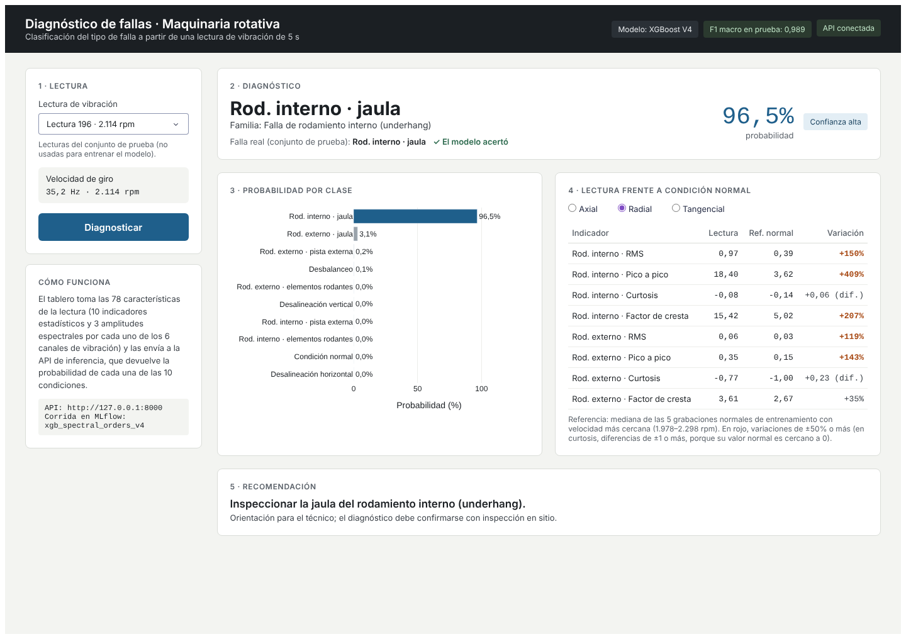
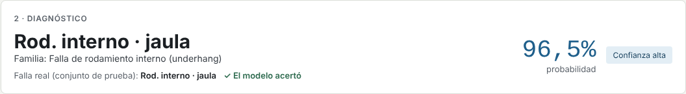
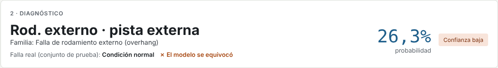
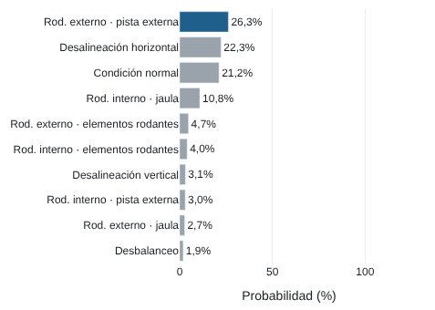

# Manual de Usuario — Tablero de Diagnóstico de Fallas

Este manual explica cómo usar el tablero de diagnóstico de fallas en maquinaria rotativa y cómo interpretar lo que muestra. Está dirigido al técnico o analista de mantenimiento; no requiere conocimientos de programación. Para instalar o poner en funcionamiento la solución, consulte el [Manual de Instalación](MANUAL_INSTALACION.md).

> **Uso rápido en 3 pasos**
>
> 1. Abra en el navegador la dirección del tablero (sección 2).
> 2. Elija una lectura en la lista **Lectura de vibración** y dé clic en **Diagnosticar**.
> 3. Lea el diagnóstico, su **nivel de confianza** y la **recomendación** de qué componente revisar.

## 1. ¿Qué hace el tablero?

El tablero le indica **qué componente revisar** en una máquina rotativa a partir de una lectura de vibración de 5 segundos. Para cada lectura le dice si la máquina está en **condición normal** o tiene una de **nueve fallas**, qué tan seguro está de ese resultado y qué conviene inspeccionar.

| Grupo | Condiciones que reconoce |
| --- | --- |
| Condiciones generales | Condición normal · Desbalanceo · Desalineación horizontal · Desalineación vertical |
| Rodamiento interno | Jaula · Pista externa · Elementos rodantes |
| Rodamiento externo | Jaula · Pista externa · Elementos rodantes |

El tablero es una herramienta de apoyo: el diagnóstico siempre debe confirmarse con una inspección en sitio.

> **Esta versión es una demostración.** Las lecturas disponibles son grabaciones de un banco de pruebas de laboratorio en las que la falla ya se conoce. Por eso el tablero muestra, junto al diagnóstico, la falla real de cada lectura: así se puede comprobar si el diagnóstico fue correcto. En un uso real en planta, la falla real no se conocería de antemano.

## 2. Cómo entrar al tablero

1. Abra un navegador web (Chrome, Edge o Firefox).
2. Escriba la dirección del tablero que le entregue el responsable técnico. Tiene esta forma: `http://<dirección>:8050`
3. Revise, en la esquina superior derecha, que aparezca el indicador **API conectada**. Significa que el servicio que calcula los diagnósticos está funcionando. Si aparece **API no disponible**, consulte la sección 6.

> **Nota:** la dirección del tablero puede cambiar cuando se reinicia el servidor. Si la página no abre, pida la dirección vigente al responsable técnico.

## 3. Lo que ve en pantalla

El tablero tiene una sola pantalla con cinco bloques, numerados en el orden en que se usan:

| Bloque | Qué muestra |
| --- | --- |
| **1 · Lectura** | La lista de lecturas, la velocidad de giro de la lectura elegida y el botón **Diagnosticar** |
| **2 · Diagnóstico** | La condición identificada, su probabilidad y el nivel de confianza |
| **3 · Probabilidad por clase** | Qué tan probable es cada una de las 10 condiciones |
| **4 · Lectura frente a condición normal** | Una comparación de la vibración de la lectura con la de una máquina sana |
| **5 · Recomendación** | El componente que conviene inspeccionar |

En la parte superior se ve también el estado de la conexión (**API conectada** o **API no disponible**) y datos del modelo de diagnóstico, explicados en la sección 9.

## 4. Cómo obtener un diagnóstico

1. En el bloque **1 · Lectura**, abra la lista **Lectura de vibración** y elija una lectura. Cada opción muestra un número de lectura y la velocidad de giro de la máquina en rpm. También puede escribir el número para buscarla, por ejemplo `196`.
2. Revise la **velocidad de giro** de la lectura.
3. Dé clic en **Diagnosticar**. En uno o dos segundos se actualizan los bloques 2 a 5.

> **Importante:** al elegir otra lectura, los resultados no cambian hasta que dé clic en **Diagnosticar**. Al abrir el tablero se muestra el diagnóstico de una lectura de ejemplo.

## 5. Cómo interpretar los resultados

### 5.1 Diagnóstico y nivel de confianza

El bloque **2 · Diagnóstico** muestra:

* **Condición identificada:** la condición más probable, por ejemplo *Rod. interno · jaula*.
* **Familia:** el tipo general de falla.
* **Probabilidad:** qué tan seguro está el tablero de esa condición, en porcentaje.
* **Nivel de confianza:** una lectura rápida de esa probabilidad, con lo que conviene hacer en cada caso:

| Nivel | Probabilidad | Qué hacer |
| --- | --- | --- |
| **Confianza alta** | 80 % o más | El diagnóstico es claro. Haga la inspección recomendada. |
| **Confianza media** | Entre 50 % y 80 % | Revise también la segunda condición más probable en el bloque 3. |
| **Confianza baja** | Menos de 50 % | El resultado no es confiable. Tome una nueva lectura o consulte a un especialista antes de intervenir. |

* **Falla real:** la condición registrada para esa grabación de laboratorio, con la marca **✓ El modelo acertó** o **✗ El modelo se equivocó** (vea la nota de demostración de la sección 1).

**Ejemplo de confianza baja.** En la lectura 298 el tablero indica una falla del rodamiento externo con solo 26,3 % de probabilidad, cuando en realidad la máquina estaba en condición normal. La confianza baja advierte que no conviene actuar sin verificar:

### 5.2 Probabilidad por clase

El gráfico del bloque **3** ordena las 10 condiciones de la más probable a la menos probable. La barra azul es la condición diagnosticada.

* Si una barra es mucho más larga que las demás, el diagnóstico es claro.
* Si dos o más barras tienen valores parecidos, el tablero duda entre esas condiciones. En la lectura 298, tres condiciones quedan entre 21 % y 26 %:

### 5.3 Lectura frente a condición normal

El bloque **4** compara cuatro indicadores de vibración de la lectura con los de una máquina sana que gira a una velocidad parecida, para el rodamiento interno y el externo:

| Indicador | Qué refleja |
| --- | --- |
| **RMS** | El nivel general de vibración |
| **Pico a pico** | La distancia entre el punto más alto y el más bajo de la vibración |
| **Curtosis** | Golpes o picos aislados, típicos de defectos en rodamientos |
| **Factor de cresta** | Qué tanto sobresalen los picos frente al nivel general; también detecta golpes |

* **Ref. normal:** el valor típico de una máquina sana, calculado con las 5 grabaciones normales de velocidad más parecida.
* **Variación:** cuánto se aleja la lectura de ese valor normal. Se marca en rojo cuando la diferencia es de 50 % o más, hacia arriba o hacia abajo. Para la curtosis se muestra la diferencia directa, por ejemplo *+0,23 (dif.)*, porque en una máquina sana su valor es cercano a cero; se marca en rojo cuando la diferencia es de 1 o más.
* **Axial, Radial y Tangencial:** eligen la dirección en la que mide el sensor de vibración. Al cambiarla, el tablero actualiza la comparación.

Este bloque ayuda a entender el diagnóstico, pero no lo reemplaza: el diagnóstico usa muchas más mediciones que estos cuatro indicadores.

### 5.4 Recomendación

El bloque **5** indica qué revisar según la condición identificada:

| Condición identificada | Recomendación |
| --- | --- |
| Condición normal | No se requiere intervención. Mantener el plan de monitoreo periódico. |
| Desbalanceo | Revisar el balanceo del rotor: masas añadidas, acumulación de material o piezas sueltas. |
| Desalineación horizontal | Revisar la alineación horizontal del acople entre el motor y el eje. |
| Desalineación vertical | Revisar la alineación vertical del acople (altura de soportes y calces). |
| Rodamiento interno o externo · jaula | Inspeccionar la jaula del rodamiento indicado. |
| Rodamiento interno o externo · pista externa | Inspeccionar la pista externa del rodamiento indicado. |
| Rodamiento interno o externo · elementos rodantes | Inspeccionar los elementos rodantes del rodamiento indicado. |

## 6. Mensajes y solución de problemas

| Situación | Qué significa | Qué hacer |
| --- | --- | --- |
| Arriba a la derecha dice **API no disponible** | El servicio que calcula los diagnósticos no responde. El tablero lo revisa cada 30 segundos. | Espere un momento y recargue la página. Si sigue igual, avise al responsable técnico. |
| El bloque 2 dice **No se pudo obtener el diagnóstico** | No fue posible calcular el diagnóstico. | Dé clic de nuevo en **Diagnosticar**. Si sigue igual, avise al responsable técnico. |
| La página no abre | El servidor está apagado o cambió su dirección. | Pida la dirección vigente al responsable técnico. |
| Los resultados no cambian al elegir otra lectura | Falta dar clic en **Diagnosticar**. | Dé clic en **Diagnosticar**. |

## 7. Limitaciones y buenas prácticas

* El tablero aprendió de grabaciones de un **banco de pruebas de laboratorio** con fallas provocadas a propósito. En otras máquinas sus resultados deben validarse antes de confiar en ellos.
* En las grabaciones de comprobación, el tablero acertó en **99 de cada 100 lecturas**. Aun así puede equivocarse: preste especial atención a los resultados con **confianza baja**.
* Use el tablero para **orientar** la inspección, nunca para reemplazarla.

## 8. Glosario

| Término | Significado |
| --- | --- |
| **Condición normal** | La máquina funciona sin fallas. |
| **Desbalanceo** | El peso del rotor no está distribuido de forma pareja, lo que lo hace vibrar al girar. |
| **Desalineación** | El eje del motor y el eje de la máquina no quedan en la misma línea (horizontal o vertical). |
| **Rodamiento interno / externo** | Los dos rodamientos que sostienen el eje: el más cercano al motor (interno) y el más alejado (externo). |
| **Jaula, pista externa, elementos rodantes** | Partes del rodamiento donde puede aparecer el defecto. |
| **Lectura de vibración** | Una grabación de 5 segundos de los sensores de vibración de la máquina. |
| **Probabilidad** | Qué tan seguro está el tablero de cada condición, de 0 % a 100 %. |
| **Nivel de confianza** | Clasificación de la probabilidad del diagnóstico en alta, media o baja. |
| **rpm / Hz** | Velocidad de giro de la máquina, en revoluciones por minuto o por segundo. |
| **API** | El servicio que recibe los datos de la lectura y calcula el diagnóstico. |

## 9. Información técnica del modelo

Esta sección es de referencia; no se necesita para usar el tablero.

* El diagnóstico lo calcula el modelo **XGBoost V4**, a partir de 78 características de la lectura (10 indicadores estadísticos y 3 componentes de frecuencia por cada uno de los 6 canales de vibración).
* El modelo se entrenó y evaluó con la base pública **MaFaulDa**. Las lecturas del tablero son las 391 grabaciones que se reservaron para comprobar el modelo y que no se usaron para entrenarlo.
* En esas grabaciones obtuvo una exactitud de **99,23 %** y un **F1 macro de 98,86 %** (el valor 0,989 que aparece en la parte superior del tablero). El F1 macro mide el desempeño dando el mismo peso a cada una de las 10 condiciones, incluidas las menos frecuentes. Solo hay 10 grabaciones normales entre las de comprobación, por lo que el desempeño en esa condición se estimó con pocos casos.
* El recuadro **Cómo funciona** del tablero indica la dirección del servicio de diagnóstico y la corrida del modelo registrada en MLflow, la herramienta con la que el equipo registró sus experimentos.
